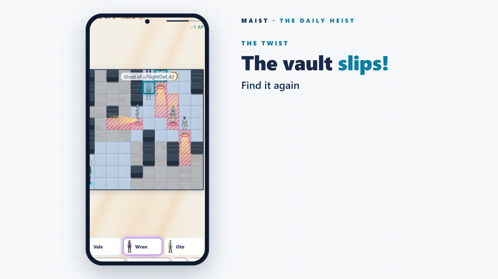

# Maist: The Daily Heist

**A turn-based stealth puzzle you play inside a Reddit post.** Every night there is a new heist, the same
for everyone: sneak a crew of three past patrolling robots and crack the vault on three dream layers.
One scored run per night, a daily leaderboard, streaks, and a community that can pull you back when
you get stuck.

- **Play it:** https://www.reddit.com/r/MaistHeist/ (a new post every day at 00:00 UTC)
- **Demo video (54 s):** https://youtu.be/HiwOTZcwHk0

[](https://youtu.be/HiwOTZcwHk0)

It works on phones and desktop, logged in or not (logged-out players can practice). Built solo on
Reddit's Developer Platform (Devvit) for Reddit's Game of the Day Hackathon 2026.

## How to play

1. Open tonight's post and tap **Start the heist**, then **Start tonight's heist**. (**Practice run** is
   always open, and never counts.)
2. You control a **crew of three**, and they share **one pool of Action Points (AP)**. Every step costs
   1 AP. The guards move after each of your actions, so the board is a puzzle you solve one turn at a time.
3. **Get any crew member onto the vault ◈** to crack the layer. Crack all three layers to finish the heist.
4. **Don't get seen.** Robots see their own tile and 2–3 tiles ahead (the red, striped tiles and their
   flashlight cone). A crew member who is seen is out for the rest of the layer.

### Controls

| | Phone | Keyboard |
|---|---|---|
| Pick a crew member | tap them, or their card | **1 / 2 / 3** |
| Move | tap a glowing tile, or swipe | **arrow keys** or **WASD** |
| Use the ability | the ability button | **E** |
| Wait (let the robots move) | **Wait** | **Q** or **Space** |

### The crew

- **Vale, the Shaper.** **Fold** (2 AP) opens a wall next to her.
- **Wren, the Ghost.** **Fade** (1 AP) makes her invisible for 2 turns.
- **Oto, the Chemist.** **Haze** (3 AP) puts a robot within 3 tiles to sleep for 2 turns (Zzz).

### The three layers

- **Easy:** robots that stand still.
- **Hard:** four patrols walking back and forth.
- **Difficult:** fog (you only see near your crew), patrols, and watchers that turn toward you.

**The vault slipped!** On layers marked **⇄**, the vault vanishes the first time you reach it and
reappears somewhere else. A gold ping shows where for one turn (through the fog too), then you have to
find it. Easy never slips, Hard slips on about half of nights, Difficult always does. Every map is checked
by a solver to be beatable within its AP.

### Score

- **200** per vault, **+100 for every AP left**, **+50** for a layer finished without a Pull, and **+100**
  for reaching a slipped vault within 5 moves.
- Your **one scored run per night** goes on the daily leaderboard (with Snoovatars). The server replays
  every run move by move, so scores can't be faked.
- Play on consecutive nights to build a **🔥 streak**.

### Adrift and the Pull

Run out of AP, or lose your whole crew, and you go **adrift**. You can ask the thread for help: the game
posts a call under the pinned crew thread. Anyone who replies **WAKE UP** sends you a **Pull**: +6 AP,
and your crew comes back. Helping each other is part of the game.

### Ghost race

On tonight's post you race a see-through **ghost of tonight's #1 run**. It takes one step each time you
act, labelled "Ghost of u/name". You can turn it off in Settings.

### After the heist

See your score, rank and streak, share your run to the thread, and tap **Join r/MaistHeist** so you
don't miss tomorrow's heist.

## Settings

The ⚙ button: **language** (English, 中文, 日本語, Deutsch, हिन्दी), **sound**, **theme** (light, dark or
system), **ghost race**, **bigger text**, and **Smooth mode**. Smooth mode switches on by itself on
low-end phones: it drops the dust, idle animations and glows, and uses smaller images. The game also
respects your device's reduced-motion setting.

## Built with

- [Devvit Web](https://developers.reddit.com/) (Reddit's Developer Platform): the client (TypeScript,
  CSS animations, no game engine), a Hono server, Redis for the leaderboards, streaks and the ghost
  run, a daily scheduler, and app triggers for the crew thread.
- One deterministic rules engine (`src/shared/heist/engine.ts`) is shared by the client, which plays,
  and the server, which replays every scored run.
- The 2D crew and robot art was made from our own generated character sheets, cut out with the free
  offline tools of sprite-gen (`scripts/build-sprites.py`). The office floor is drawn in code.

## For developers

```
npm install
npm run dev          # devvit playtest on the dev subreddit
npm run test:unit    # rules engine and calendar tests
npx tsc --build      # typecheck
npm run lint
npm run build
```

More detail: [`docs/HEIST.md`](docs/HEIST.md).
